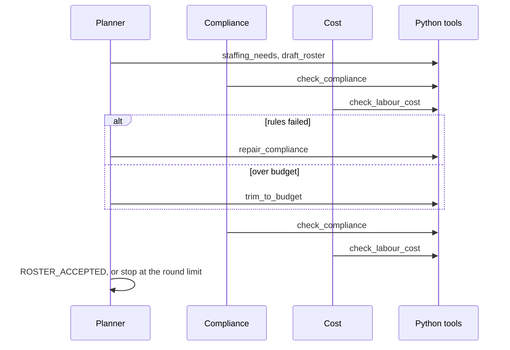

# Multi-agent roster builder


A small **AutoGen team** that builds a weekly restaurant roster. One agent drafts shifts from hourly foot-traffic counts. Two others check the draft by calling Python: sample shift rules, and labour cost against a weekly target. They go round until both checks pass or they hit a turn limit.

The counts are **fictional**. They are the shape of a file a computer-vision people-counter on a venue's existing CCTV would write (one row per day and hour). This repo does not read video, connect to a camera, or run a detector.

Names, hours and dollars come from the tools. The model picks which tool to call. It does not get to invent the figures.

> **Demo project with sample data.** Everything in `data/` is invented for Helio Grill, a made-up venue. The rules in `data/rules.json` are house rules I wrote for the demo. They are **not legal advice** and not an interpretation of any award, agreement, or statute. Labour cost is base rate times paid hours. No penalty rates, loadings, overtime, or super.

## Why I built this

I rostered sites as a Business Manager at Grill'd and Mad Mex. The hard part was the second pass: a close with nobody trained to lock up, a long shift with no break, or a labour line that had already crept over. I run [Visionroster](https://visionroster.ai), which reads a venue's existing CCTV and turns the video into foot-traffic counts a roster can follow. This repo is only that last step, the roster, so I could show the agent loop on its own.

## How it works



1. `run.py` builds an `AzureOpenAIChatCompletionClient` (`autogen-ext`) and a `RoundRobinGroupChat` of three `AssistantAgent`s (`autogen-agentchat` 0.7.5).
2. The order is fixed: planner, compliance, cost, then the planner again. A selector model would be another paid call, and it can skip the cost check. The review order does not need a model to pick the next speaker.
3. The planner calls `staffing_needs`, then `draft_roster`. Headcount is arithmetic. Front of house is one person per 28 entries, minimum one while the store is open, capped at four. Kitchen is 0 below 18 entries, 1 until 50, then 2.
4. Compliance calls `check_compliance`. Cost calls `check_labour_cost`. `reflect_on_tool_use` is off, so the team sees the tool JSON, not a paraphrase of the dollars.
5. If the rules fail, the planner calls `repair_compliance`. If only the budget fails, it calls `trim_to_budget`.
6. The team stops when the planner says `ROSTER_ACCEPTED`, says `ROSTER_STOPPED`, or 16 messages have been produced.
7. `run.py` runs both checks again in Python before it treats the roster as accepted. The model's sentence is not the result.

`offline_demo.py` walks the same tools in that order with no model and no keys. The roster does not change between runs.

### Sample rules

From `data/rules.json`. Deliberately simple.

| Rule | Demo setting |
| --- | --- |
| Minimum shift | 3 hours |
| Meal break | 30 minutes, unpaid, if the shift is longer than 5 hours |
| Rest between shifts | 10 hours, including Sunday night into Monday |
| Weekly maximum | the person's own cap, and a house cap of 40 hours |
| Open | 11:00 needs an open-trained **front** person on shift |
| Close | 21:00 needs a close-trained **front** person on shift |

A kitchen person with `can_close` does not satisfy the close. Hannah is on the roster with that flag so the check is visible. Shifts also have to sit inside each person's availability.

### Tools

| Tool | Who calls it | What the Python does |
| --- | --- | --- |
| `staffing_needs` | Planner | Hourly entries and the headcount that implies |
| `draft_roster` | Planner | Covers each hour from availability, skills, rate, and the weekly cap. Does not insert meal breaks |
| `repair_compliance` | Planner | Bridges rest gaps, extends short shifts, places an opener and a closer, then inserts unpaid meal breaks |
| `trim_to_budget` | Planner | Drops surplus edge hours, dearest first, and will not break a rule or leave demand uncovered to save money |
| `check_compliance` | Compliance | The rules above. Returns violations or `COMPLIANCE_PASS` |
| `check_labour_cost` | Cost | Paid hours times base rate, against the weekly budget |

The draft leaves meal breaks out on purpose. Inserting them is the checker's job, then a separate repair. I didn't want the drafter grading its own homework.

## Project structure

```
multi-agent-roster-builder/
├── roster_builder/
│   ├── agents.py      # the three AssistantAgents and the round-robin team
│   ├── tools.py       # the six tools, over a small in-memory roster
│   ├── draft.py       # greedy cover, repair, trim
│   ├── rules.py       # headcount, compliance, cost
│   ├── data.py        # load the CSVs and rules.json
│   ├── scripted.py    # the no-model path through the same tools
│   ├── report.py      # the roster table
│   └── config.py      # .env to AzureOpenAIChatCompletionClient settings
├── data/              # FICTIONAL foot traffic, staff, availability, pay, rules
├── tests/             # offline. No keys, no network
├── run.py             # Azure OpenAI
├── offline_demo.py    # no credentials
├── requirements.txt
├── pytest.ini         # repo root on sys.path for pytest
├── .env.example
└── LICENSE
```

## Setup

```bash
git clone https://github.com/sivakowshik/multi-agent-roster-builder.git
cd multi-agent-roster-builder
python3 -m venv .venv
source .venv/bin/activate        # Windows: .venv\Scripts\activate
pip install -r requirements.txt
```

### Try it without Azure

```bash
python offline_demo.py   # same tools, fixed path, prints the roster
pytest -q                # 18 offline tests
```

### Run the team with Azure OpenAI

1. Deploy a chat model that supports tool calling, for example `gpt-4o-mini`.
2. Copy the settings file and fill in the resource endpoint, key, deployment name, and model name:

   ```bash
   cp .env.example .env
   ```

   `AZURE_OPENAI_ENDPOINT` is the resource root, for example `https://<your-resource>.openai.azure.com/`. No `/openai/v1` suffix. That suffix belongs to the OpenAI SDK's v1 base URL, and this client does not want it.

3. Build the week:

   ```bash
   python run.py
   python run.py --max-messages 16
   ```

The process prints the AgentChat transcript, then a Python re-check, then the same roster table as the offline demo. If the planner says `ROSTER_ACCEPTED` and the tools disagree, the re-check says so and the exit code is 2.

## Example output

This is `python offline_demo.py` on the sample week. The command prints all 15 meal-break violations. Two are enough to show the shape.

```
Helio Grill weekly roster. Fictional sample data. No Azure calls.

planner -> staffing_needs
  Monday     busiest 13:00  entries 58  front 3  kitchen 2
  Saturday   busiest 19:00  entries 90  front 4  kitchen 2

planner -> draft_roster
  50 shifts, 260 paid hours, $7,381.00 before rule repair

compliance -> check_compliance  COMPLIANCE_FAIL
  - Ben Walsh, Saturday 11:00-22:00 is 11h with a 0m break. Sample rule: a shift longer than 5h needs a 30m meal break.
  - Maya Patel, Monday 13:00-22:00 is 9h with a 0m break. Sample rule: a shift longer than 5h needs a 30m meal break.
  ... 13 more, same rule

cost -> check_labour_cost  COST_FAIL
  labour $7,381.00  budget $7,300.00  over by $81.00

planner -> repair_compliance
  - set a 30m unpaid meal break on 15 shifts over 5h

compliance -> check_compliance  COMPLIANCE_PASS
cost -> check_labour_cost  COST_PASS
  labour $7,167.00  budget $7,300.00  under by $133.00

planner: ROSTER_ACCEPTED
```

The $214 drop is 15 unpaid half hours. The budget is a sample target I set between those two totals so the cost check has a fail to report. A real target would come from sales, not from this gap.

| Day | Staff | Area | Start | End | Break | Paid | Cost |
| --- | --- | --- | --- | --- | --- | --- | --- |
| Monday | Ben Walsh | kitchen | 11:00 | 14:00 | 0m | 3h | $73.50 |
| Monday | Sofia Rossi | front | 11:00 | 14:00 | 0m | 3h | $84.00 |
| Monday | Priya Shah | front | 12:00 | 22:00 | 30m | 9.5h | $247.00 |
| Monday | Aisha Rahman | kitchen | 13:00 | 16:00 | 0m | 3h | $81.00 |
| Monday | Maya Patel | front | 13:00 | 22:00 | 30m | 8.5h | $289.00 |
| Monday | Hannah Okonkwo | kitchen | 17:00 | 21:00 | 0m | 4h | $128.00 |
| Tuesday | Aisha Rahman | kitchen | 11:00 | 14:00 | 0m | 3h | $81.00 |
| Tuesday | Sofia Rossi | front | 11:00 | 15:00 | 0m | 4h | $112.00 |
| Tuesday | Priya Shah | front | 12:00 | 20:00 | 30m | 7.5h | $195.00 |
| Tuesday | Hannah Okonkwo | kitchen | 13:00 | 16:00 | 0m | 3h | $96.00 |
| Tuesday | Marco Silva | kitchen | 17:00 | 21:00 | 0m | 4h | $114.00 |
| Tuesday | Liam Nguyen | front | 18:00 | 22:00 | 0m | 4h | $116.00 |
| Wednesday | Aisha Rahman | kitchen | 11:00 | 14:00 | 0m | 3h | $81.00 |
| Wednesday | Sofia Rossi | front | 11:00 | 14:00 | 0m | 3h | $84.00 |
| Wednesday | Hannah Okonkwo | kitchen | 12:00 | 19:00 | 30m | 6.5h | $208.00 |
| Wednesday | Jonah Blake | front | 12:00 | 15:00 | 0m | 3h | $75.00 |
| Wednesday | Maya Patel | front | 13:00 | 20:00 | 30m | 6.5h | $221.00 |
| Wednesday | Ethan Cole | front | 17:00 | 22:00 | 0m | 5h | $137.50 |
| Wednesday | Marco Silva | kitchen | 17:00 | 21:00 | 0m | 4h | $114.00 |
| Thursday | Aisha Rahman | kitchen | 11:00 | 14:00 | 0m | 3h | $81.00 |
| Thursday | Sofia Rossi | front | 11:00 | 14:00 | 0m | 3h | $84.00 |
| Thursday | Hannah Okonkwo | kitchen | 12:00 | 20:00 | 30m | 7.5h | $240.00 |
| Thursday | Priya Shah | front | 12:00 | 15:00 | 0m | 3h | $78.00 |
| Thursday | Maya Patel | front | 13:00 | 20:00 | 30m | 6.5h | $221.00 |
| Thursday | Ethan Cole | front | 17:00 | 22:00 | 0m | 5h | $137.50 |
| Thursday | Liam Nguyen | front | 18:00 | 21:00 | 0m | 3h | $87.00 |
| Thursday | Marco Silva | kitchen | 18:00 | 22:00 | 0m | 4h | $114.00 |
| Friday | Ben Walsh | kitchen | 11:00 | 14:00 | 0m | 3h | $73.50 |
| Friday | Jonah Blake | front | 11:00 | 21:00 | 30m | 9.5h | $237.50 |
| Friday | Sofia Rossi | front | 11:00 | 14:00 | 0m | 3h | $84.00 |
| Friday | Aisha Rahman | kitchen | 12:00 | 17:00 | 0m | 5h | $135.00 |
| Friday | Maya Patel | front | 12:00 | 21:00 | 30m | 8.5h | $289.00 |
| Friday | Hannah Okonkwo | kitchen | 17:00 | 21:00 | 0m | 4h | $128.00 |
| Friday | Marco Silva | kitchen | 17:00 | 22:00 | 0m | 5h | $142.50 |
| Friday | Ethan Cole | front | 18:00 | 22:00 | 0m | 4h | $110.00 |
| Saturday | Ben Walsh | kitchen | 11:00 | 22:00 | 30m | 10.5h | $257.25 |
| Saturday | Jonah Blake | front | 11:00 | 22:00 | 30m | 10.5h | $262.50 |
| Saturday | Maya Patel | front | 11:00 | 15:00 | 0m | 4h | $136.00 |
| Saturday | Hannah Okonkwo | kitchen | 12:00 | 15:00 | 0m | 3h | $96.00 |
| Saturday | Priya Shah | front | 12:00 | 21:00 | 30m | 8.5h | $221.00 |
| Saturday | Marco Silva | kitchen | 16:00 | 21:00 | 0m | 5h | $142.50 |
| Saturday | Ethan Cole | front | 17:00 | 20:00 | 0m | 3h | $82.50 |
| Saturday | Liam Nguyen | front | 18:00 | 22:00 | 0m | 4h | $116.00 |
| Sunday | Ben Walsh | kitchen | 11:00 | 20:00 | 30m | 8.5h | $208.25 |
| Sunday | Jonah Blake | front | 11:00 | 21:00 | 30m | 9.5h | $237.50 |
| Sunday | Maya Patel | front | 11:00 | 15:00 | 0m | 4h | $136.00 |
| Sunday | Hannah Okonkwo | kitchen | 12:00 | 15:00 | 0m | 3h | $96.00 |
| Sunday | Priya Shah | front | 12:00 | 20:00 | 30m | 7.5h | $195.00 |
| Sunday | Liam Nguyen | front | 18:00 | 22:00 | 0m | 4h | $116.00 |
| Sunday | Marco Silva | kitchen | 18:00 | 21:00 | 0m | 3h | $85.50 |

Week: 50 shifts, 252.5 paid hours, labour $7,167.00, budget $7,300.00.

Hours are `[start, end)`. A shift of 17:00-22:00 covers the 21:00 close. A 30 minute break is unpaid, so a 10 hour span is 9.5 paid hours.

## Tests

All 18 tests run offline. Nothing is mocked over the network because the model is not called.

- `tests/test_rules.py`: headcount, meal break, minimum length, the Sunday-to-Monday rest gap, overlap, weekly cap, availability, and the kitchen closer who does not count. Cost is checked in cents (`330 minutes * $27.50 = $151.25`).
- `tests/test_draft.py`: the sample draft fails the rules, repair clears them and still covers demand, a same-day split gets bridged, trim drops a surplus edge and will not remove the only opener.
- `tests/test_scripted.py`: the offline path accepts the sample week, the first compliance check really fails, and a second run produces the same shifts.
- `tests/test_team.py`: the AgentChat 0.7.5 symbols import, the team is planner then compliance then cost with the right tools, and a missing `.env` exits with a short message instead of a stack trace.

## Security notes

- Secrets live in `.env`, which is git-ignored. Only `.env.example` is committed.
- This demo uses an API key. For anything real I would use Microsoft Entra ID and drop the key.

## Limitations

- Not legal advice. Not the Fast Food Award, the Hospitality Award, or any enterprise agreement.
- No penalty rates, casual loading, overtime, or salaried managers. A 30 minute meal break is simply unpaid.
- No video and no people-counter. The CSV is hand-written sample data.
- The draft is greedy. It prefers a cheaper person who is already next to the hour, so a weekend cook can land an 11 hour Saturday. There is no maximum day length.
- Once the budget passes, surplus at the edge of a long shift stays. `trim_to_budget` only runs when the cost check fails, and it will not understaff an hour to save money.
- The weekly target of $7,300 is a sample number sitting between the unrepaired draft and the repaired roster.
- Microsoft has archived the AutoGen GitHub repository. I pinned `autogen-agentchat` and `autogen-ext` at 0.7.5, which is the current release on PyPI, and wrote against that AgentChat API. The rule checks do not depend on another AutoGen release.
- A model can still say `ROSTER_ACCEPTED` without calling a tool. `run.py` does not trust that sentence.

## What I'd do next

- A maximum day length, so Saturday does not collapse onto the cheapest cook.
- Let the planner submit a structured edit (a list of shifts) and run it through the same checks, once I have a few bad weeks as an eval and can see it stop breaking a roster that already passed.
- Penalty rates by day and time, still in Python, still not an award interpretation.
- Point `foot_traffic.csv` at the hourly counts Visionroster already writes, instead of a sample file.
- When the greedy draft cannot hit a real sales-based budget, call a solver (OR-Tools) as a tool rather than asking the model to delete shifts by hand.
- Entra ID on the Azure client instead of an API key.

## Author

**Siva Kowshik Sripathi Panditharadyula**, AI Engineer, Melbourne. AI-103, AZ-900, AI-900, Databricks Fundamentals.

[Portfolio](https://sivakowshik.github.io) · [GitHub](https://github.com/sivakowshik) · [LinkedIn](https://www.linkedin.com/in/siva-kowshik-sripathi-panditharadyula-241713150) · kowshik.sps451@gmail.com
